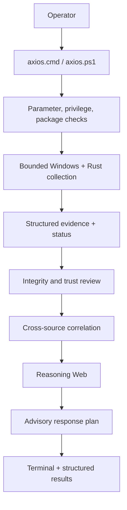

# AXIOS Architecture

> Collection produces evidence. Validation establishes its quality. Correlation links related observations. Reasoning evaluates supported explanations. Only then does AXIOS present a conclusion.

**Golden rule:** a later layer must preserve the uncertainty, errors, and visibility limits reported by an earlier one.

**Jump to:** [Overview](#overview) · [Boundaries](#five-boundaries) · [Repository](#repository-and-release-package) · [Layers 1–9](#1-public-interface) · [Contract](#end-to-end-contract) · [Design rules](#design-rules)

---

## Overview



| Layer | Responsibility |
|---|---|
| Public interface | Interpret the requested mode and validate its parameters |
| Orchestration | Run required components in order and preserve their results |
| Collection | Observe Windows sources within explicit limits |
| Normalization | Make evidence comparable without inventing missing values |
| Integrity review | Check reports, references, package components, and collection status |
| Correlation | Link related observations while retaining their sources |
| Reasoning | Evaluate support, conflicts, alternatives, and unresolved facts |
| Response planning | Suggest what an investigator should verify next |
| Results | Show conclusions together with coverage and supporting evidence |

## Five boundaries

1. **PowerShell coordinates execution.** It validates requests, chooses runners, and checks native exit codes.
2. **Rust collects and analyzes evidence.** Packaged executables do the bounded native work.
3. **Structured reports connect layers.** Status, errors, findings, context, and provenance travel with the evidence.
4. **Correlation respects evidence quality.** Missing or failed collection cannot become corroboration.
5. **Results preserve limitations.** A completed workflow is not a claim of complete visibility or a clean system.

---

## Repository and release package

The source repository and the extracted Windows package have different layouts.

| Repository path | Responsibility |
|---|---|
| `installer/windows/axios.cmd` | CMD wrapper; starts PowerShell and enables the per-user result cache |
| `installer/windows/axios.ps1` | Public PowerShell parameter interface |
| `installer/windows/Run-AXIOS.ps1` | Mode routing, preflight, session handling |
| `installer/windows/Run-AXIOS-Layer.ps1` | Focused investigation and Results handling |
| `installer/windows/Run-AXIOS-Complete-Investigation.ps1` | Complete Administrator investigation |
| `installer/windows/Invoke-AXIOS-Mission.ps1` | Mission orchestration |
| `installer/windows/Write-AXIOS-Terminal-Results.ps1` | Human-readable terminal output |
| `src/`, `src/bin/` | Shared Rust code, standalone collectors and analyzers |
| `tests/` | Interface, evidence, privacy, runtime, and package contracts |
| `scripts/build-windows-complete-investigation.sh` | Windows build and single-file CMD packaging |
| `README.md`, `Commands.md`, `Windows.md`, `Architecture.md` | Documentation |

**Build:** the release builder cross-compiles the Windows executables, assembles the package, writes `SHA256SUMS.txt`, checks the archive, and embeds it in `axios-windows-investigation.cmd`.

**Extracted package** (`Downloads\AXIOS\axios-windows-investigation`):

```text
axios.cmd, axios.ps1      public entry points
scripts\                  PowerShell runners
bin\                      native executables
(docs) + manifest         documentation and integrity manifest
```

The GitHub-generated source ZIP does **not** contain the packaged executables.

---

## 1. Public interface

```text
Release CMD        → extraction only
Extracted axios.cmd → PowerShell process → axios.ps1
Direct axios.ps1   → same parameter interface
```

The extractor shows progress and returns without starting an investigation. After extraction, operators pick a mode explicitly:

- **Main assessments:** `User`, `Network`, `Administrator`
- **Also available:** `System`, `Persistence`, `Software`, `Help`, `Results`
- **Developer (separate, explicit):** exposure and credential commands. Credential data is never part of normal results.

Mode-specific options are validated before dispatch: a User focus belongs to `User`, targets and ports to `Network`, file-audit options to `Administrator`. Operators never launch individual Rust executables.

## 2. Windows orchestration

```text
axios.ps1 → Run-AXIOS.ps1 → focused layer runner OR complete investigation runner → PowerShell + Rust components
```

It handles mode and parameter routing, privilege and package preflight, working-directory and session management, native executable invocation and exit-code checks, report collection and coverage tracking, terminal rendering, and result retention.

Only `Administrator` requires elevation. Standard-user modes can run while a protected source stays unavailable, and orchestration **must report that gap**: permission to start a mode is not proof every collector succeeded.

**Result retention**

| Entry point | Behavior |
|---|---|
| `axios.cmd` | Per-user cache; `Results` works across CMD invocations |
| Direct `axios.ps1` (unsaved) | Current PowerShell session only |
| `-Save` | Retains requested artifacts |

## 3. Native collection

| Area | Examples |
|---|---|
| Execution | Processes, paths, runtime and memory indicators |
| Persistence | Registry entries, services, tasks, startup locations |
| Network | Adapters, DNS, routes, endpoints, listeners, firewall context |
| Platform | Hardware, firmware, boot, Secure Boot |
| Kernel | Driver and kernel trust evidence |
| Defenses | Defender, security controls, Code Integrity |
| Identity | Access and privilege surfaces |
| Telemetry | Available Windows event evidence |
| Files and software | Metadata, hashes, applications, update exposure |

Each collector works within defined time, file, event, output, or evidence limits and returns observations and findings with status, errors, and visibility limits. **A denied source never produces an empty "clean" result.**

## 4. Normalization

Windows evidence differs across versions, languages, configurations, and privilege levels. Normalization makes comparable fields consistent while keeping their meaning. It handles optional fields, paths, legacy interfaces, localized output, duplicate observations, structured errors, and partial coverage.

> **Normalization cannot manufacture a value the source did not provide.** Missing stays missing; unavailable stays unavailable.

## 5. Integrity and trust review

Before higher-level analysis, AXIOS checks whether reports and the package meet their contracts:

- Required package components and manifest entries
- Missing, failed, or partial collector reports
- Report structure and evidence references
- Duplicate observations and contradictory results
- Signature, access-control, or trust states, when available
- Claims that exceed their evidence

The manifest confirms extracted components match recorded hashes. That is an **integrity check, not proof of safety**. An unknown signature never becomes a verified one, and a missing report never becomes a success with zero findings.

## 6. Cross-source correlation

Correlation connects evidence about the same file, process, service, persistence entry, endpoint, or activity, keeping references to the original collectors.

*Example:* an executable linked to a startup entry, a running process, and a listening endpoint. A writable path or unavailable trust result adds context but proves nothing alone. Independent evidence can justify higher-priority review, and trustworthy context can reduce noise.

Copies of one observation are not independent support. Contradictions stay visible instead of being resolved in favor of a convenient conclusion.

## 7. Reasoning Web

```text
Observation → candidate explanation → supporting and conflicting evidence
            → missing verification → bounded confidence and next steps
```

It retains competing explanations and unresolved facts, and follows six rules:

1. Context is not confirmed compromise.
2. Duplicates do not increase independent support.
3. Missing evidence cannot support a positive claim.
4. Conflicts must remain visible.
5. Confidence cannot exceed the quality of its evidence.
6. Strong threat language needs stronger support than a configuration weakness or review item.

## 8. Response planning

Supported findings, unresolved questions, and collection gaps become an ordered plan for a human investigator: urgent verification, configuration review, evidence preservation, or additional collection.

> **The plan is advisory.** Public AXIOS commands never kill processes, delete artifacts, quarantine files, or change Windows security settings.

## 9. Results and preservation

The terminal renderer shows a useful summary and coverage without exposing unnecessary internal paths or machine receipts. Structured results keep:

- Collector status, errors, and visibility limits
- Findings, review items, and context observations
- Evidence provenance and correlation references
- Contradictions and unresolved facts
- Reasoning and response-plan items
- Performance and integrity metadata

Saving is explicit (`-Save`). Reports can contain sensitive machine data, so sanitize before sharing. The developer credential view stays outside normal User, Network, and Administrator result files.

---

## End-to-end contract

| # | Step | Required behavior |
|:-:|---|---|
| 1 | Validate | Check mode, options, privilege, target format, package prerequisites |
| 2 | Collect | Gather bounded evidence from available Windows sources |
| 3 | Preserve status | Record complete, partial, failed, or unavailable work truthfully |
| 4 | Normalize | Align fields without concealing missing data |
| 5 | Review | Check integrity, references, duplicates, trust, contradictions |
| 6 | Correlate | Link related observations and keep provenance |
| 7 | Reason | Evaluate explanations, confidence, conflicts, gaps |
| 8 | Plan | Prioritize human verification and further collection |
| 9 | Present | Show findings alongside coverage and supporting evidence |

## Design rules

A change to any layer must preserve these contracts:

- ❌ Never turn failed, denied, missing, or limited collection into clean evidence.
- ❌ Never invent a source value or count duplicates as independent support.
- ✅ Keep the collector and evidence references behind every finding.
- ✅ Keep contradictions and uncertainty visible through the final result.
- ✅ Bound expensive collection and report when a limit is reached.
- ✅ Separate observations, verified findings, and advisory actions.
- ✅ Preserve non-destructive public investigation behavior.
- ✅ Validate changes at the relevant interface, and on Windows when native behavior changes.

---

See [Commands.md](Commands.md) for the public interface, [Windows.md](Windows.md) for privileges and visibility, and [Contributing.md](Contributing.md) for validation requirements.
